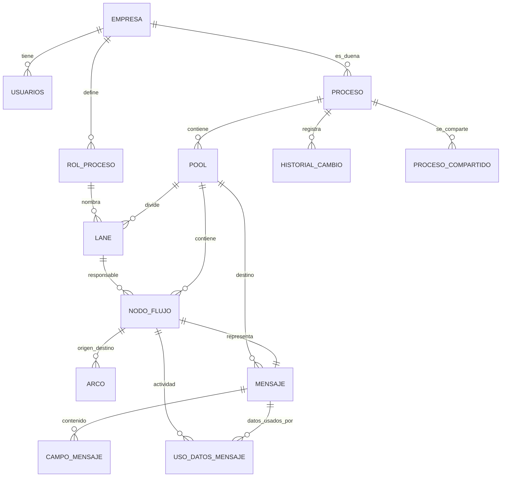

# Guía técnica del backend

## 1. Arquitectura en capas

```
Controller (REST, DTOs, @Valid)  →  Service (reglas, @Transactional, @PreAuthorize)  →  Repository (Spring Data JPA)
                                                    ↘ Entity (JPA) ↙
```

- Los controladores solo reciben, delegan y responden con `ResponseEntity` o el código adecuado; nunca usan repositorios ni entidades (lo verifica ArchUnit).
- Los servicios reciben el `empresaId` como parámetro, tomado del `ApiPrincipal` del token; nunca del cliente.
- Cada recurso tiene una única puerta de carga (`obtenerDeEmpresa`) que filtra por empresa en la consulta: lo ajeno responde 404.
- Todo lo que el usuario elimina es lógico (`activo = false`); la base tiene además `ON DELETE CASCADE` para la integridad física.

### Paquetes

| Paquete | Contenido |
|---|---|
| `common` | `EntidadAuditada`, `EntidadDeEmpresa`, excepciones, `GlobalExceptionHandler`, `PageResponse`, lista blanca de orden |
| `config` | Auditoría JPA, OpenAPI, inicializador de datos |
| `security` | `SecurityConfig`, `JwtService`, filtro JWT, `ApiPrincipal`, 401/403 en ProblemDetail |
| `gestion` | Empresas, usuarios, inicio de sesión, procesos, historial, roles de proceso, compartición |
| `modelado` | Pools, lanes, nodos (actividades, gateways, eventos), arcos, mensajes, validador, diagrama |

## 2. Modelo de datos



- `NodoFlujo` es un solo tipo de entidad para actividad, gateway, evento de inicio/fin, Message Throw y Message Catch, porque el arco une cualquiera de ellos. Cada historia de usuario conserva su propio servicio, DTO y controlador.
- `UsoDeDatosMensaje` es una tabla intermedia como entidad: admite borrado lógico y cascada en la base.
- Todas las entidades de negocio extienden `EntidadDeEmpresa` (`empresa_id` no actualizable) y `EntidadAuditada` (creado/modificado en y por).

## 3. Historias de usuario → implementación

| HU | Endpoint | Servicio | Reglas principales |
|---|---|---|---|
| 01 | `POST /empresas` | `EmpresaService.registrar` | NIT único, administrador inicial con BCrypt |
| 02 | `/usuarios` | `UsuarioService` | Solo administrador; rol de acceso; desactivar sin borrar; siempre un administrador activo |
| 03 | `/auth/login`, `/auth/yo`, `/auth/logout` | `AuthService`, `JwtService` | Mensaje genérico; usuario vigente en cada petición |
| 04 | `POST /procesos` | `ProcesoService.crear` | Nombre único por empresa; nace en BORRADOR con el pool propietario |
| 05 | `PUT /procesos/{id}` | `ProcesoService.actualizar` | Administrador o editor; historial con valor anterior y nuevo; publicar exige coherencia |
| 06 | `DELETE /procesos/{id}` | `ProcesoService.eliminar` | Solo administrador; lógico; consultable con `activo=false` |
| 07 | `GET /procesos`, `/{id}`, `/{id}/diagrama`, `/{id}/historial` | `ProcesoService`, `DiagramaService` | Búsqueda, filtros, paginación; diagrama completo |
| 08–10 | `/lanes/{id}/actividades`, `/actividades/{id}` | `ActividadService` | Lane = responsable; nombre único; eliminar arrastra arcos y advierte |
| 11–13 | `/arcos`, `/arcos/{id}` | `ArcoService` | Sin bucle, sin duplicado, sin cruzar pools; condición solo desde gateway |
| 14–16 | `/lanes/{id}/gateways`, `/gateways/{id}` | `GatewayService` | Tipo y símbolo; paralelo sin condiciones; ramas sin decisión |
| 17–20 | `/roles-proceso` | `RolProcesoService` | Único; renombrar actualiza lanes; en uso no se elimina |
| 21 | `/procesos/{id}/pools`, `/pools/{id}` | `PoolService` | Propietario único; sistema externo caja negra |
| 22 | `/pools/{id}/lanes`, `/lanes/{id}` | `LaneService` | Rol de la empresa; reordenar; lane con elementos no se elimina |
| 23 | `/procesos/{id}/compartir`, `/procesos/compartidos` | `ProcesoService` | Solo lectura para la invitada |
| 24 | `/pools/{id}/permisos`, `/pools/{id}/roles-disponibles` | `PoolService`, `ReglasDeEstructura` | Lector solo ve; editor según el permiso |
| 25 | `/procesos/{id}/mensajes/throw` | `MensajeService.crearThrow` | Cruza a otro pool del mismo diagrama; aviso sin receptor |
| 26 | `/procesos/{id}/mensajes/externos` | `MensajeService.crearEnvioExterno` | Caja negra; destino, datos, momento, política de fallo |
| 27 | `/procesos/{id}/mensajes/catch` | `MensajeService.crearCatch` | Inicio o intermedio; emisor homónimo u origen externo |
| 28 | `/mensajes/{id}/correlacion` | `MensajeService.definirCorrelacion` | Clave coherente; avisos de faltante y ambigua |

## 4. Códigos HTTP

| Código | Cuándo |
|---|---|
| 200 / 201 / 204 | Consulta o edición / creación con `Location` / eliminación o logout |
| 400 | Validación (`errors` por campo), JSON ilegible, parámetro inválido u orden no permitido |
| 401 | Sin token, token inválido o expirado, usuario desactivado, credenciales incorrectas |
| 403 | El rol de acceso no permite la operación |
| 404 | No existe o es de otra empresa |
| 409 | Regla de negocio o del modelo BPMN (`detalles` con la lista cuando aplica), conflicto de versión |
| 500 | Error inesperado, sin detalles internos |

## 5. Estrategia de pruebas

| Tipo | Herramienta | Qué cubre |
|---|---|---|
| Repositorio | `@DataJpaTest` | Consultas derivadas, JPQL, named queries, restricciones, cascada |
| Servicio | JUnit 5 + Mockito | Cada regla de negocio y excepción |
| Controlador | `@WebMvcTest` + MockMvc | Mapeo, validación, códigos HTTP |
| Integración | `@SpringBootTest` + MockMvc + JWT real | Las 28 HU de punta a punta, una transacción por petición |
| Aislamiento | `@ParameterizedTest` | Cada recurso de otra empresa responde 404 en lectura, edición y borrado |
| Arquitectura | ArchUnit | Capas, nombres, multiempresa, inyección por constructor |
| Manual / evidencia | Postman + Newman | Colección `postman/` con pruebas en cada petición |

Cobertura medida con JaCoCo: mínimo 50 % de línea en el proyecto y 70 % de línea / 60 % de rama en los servicios.

## 6. Entrega 3 (preparado)

- Seguridad: ya está activa (JWT, roles, aislamiento).
- Despliegue: `.github/workflows/deploy.yaml` (imagen a GHCR + microk8s con runner self-hosted, se ejecuta a mano hasta registrar el runner) y `k8s/deployment.yaml`.
- Pendiente para la entrega 3: pruebas E2E con Selenium sobre el frontend, pruebas de carga y migraciones con Flyway.
